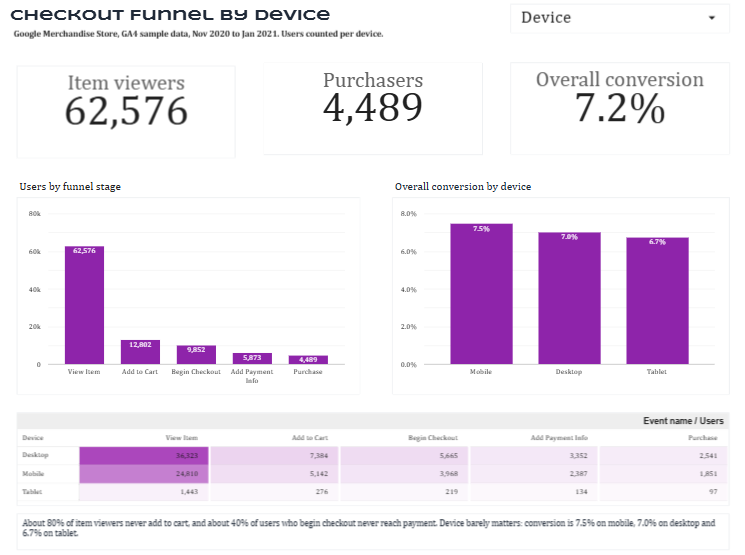
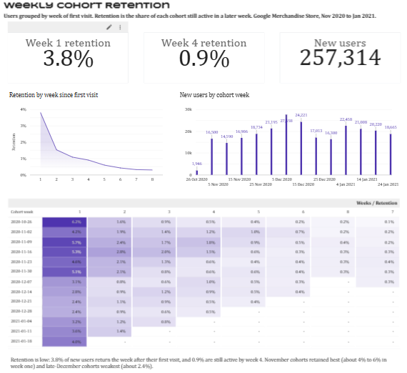

# Checkout Drop-Off Diagnostics: GA4 E-Commerce Analysis

**Business question:** Where does the Google Merchandise Store lose the most revenue in its purchase journey, and would a fix be worth it?


## Dashboard preview





[Download the dashboard as a PDF](dashboard/Checkout_Drop-Off_Diagnostics.pdf)

## Data

Google's public GA4 sample dataset for the Merchandise Store, queried in BigQuery
(`bigquery-public-data.ga4_obfuscated_sample_ecommerce`). It covers Nov 1, 2020 to Jan 31, 2021:
about 4.3M events, 270K users and 360K sessions. Google obfuscates the data.

## Approach

SQL in BigQuery aggregates the raw event data into small result tables. Python (pandas, statsmodels,
seaborn) calculates rates, runs the statistical test and exports the dashboard tables. Each query lives
once, in `sql/`, and each notebook loads its query with a single line. The exported CSVs feed a
two-page Looker Studio dashboard.

## Project structure

```
Ecommerce Analytics/
├── README.md
├── requirements.txt
├── src/
│   └── bq_client.py              # BigQuery client and run() helper
├── sql/
│   ├── 01_event_profile.sql      # event counts, users and sessions per event
│   ├── 02_funnel_by_device.sql   # funnel stage users by device
│   ├── 03_cohort_retention.sql   # weekly first-visit cohorts and activity
│   └── 04_ab_inputs.sql          # one row per user for the A/B test
├── notebooks/
│   ├── 01_data_profiling.ipynb
│   ├── 02_funnel_analysis.ipynb
│   ├── 03_cohort_analysis.ipynb
│   └── 04_ab_test_and_impact.ipynb
└── dashboard/
    ├── data/
    │   ├── funnel_by_device.csv      # exported from notebook 02
    │   └── cohort_retention.csv      # exported from notebook 03
    ├── funnel_page.png
    ├── cohort_page.png
    └── Checkout_Drop-Off_Diagnostics.pdf
```

## Findings

### 1. Purchase funnel

| Stage | Users | Kept from previous stage |
|---|---|---|
| View item | 61,252 | n/a |
| Add to cart | 12,545 | 20.5% |
| Begin checkout | 9,715 | 77.4% |
| Add payment info | 5,751 | 59.2% |
| Purchase | 4,419 | 76.8% |

7.2% of users who viewed an item went on to purchase. The shipping step (`add_shipping_info`) fires
together with `begin_checkout` (9,714 vs 9,715 users) and is excluded as redundant.

By device, the funnel is nearly identical. Overall view-to-purchase conversion is 7.5% on mobile,
7.0% on desktop and 6.7% on tablet, and every step rate is within a few points across devices. The
leaks are store-wide rather than device-specific: about 80% of item viewers never add to cart, and
about 40% of users who begin checkout never reach payment.

The dashboard counts users per device, so a user active on two devices appears once in each. Its
totals (62,576 viewers, 4,489 purchasers) sit slightly above the store-wide figures in the table above.

### 2. Cohort retention

Users are grouped by the week of their first visit, and weekly activity is tracked from that point.
Retention is low: 3.8% of new users return the week after their first visit and 0.9% are still active
in week 4, weighted by cohort size. Week-one retention ranges from 2.4% to 6.2% across cohorts.
November cohorts retain best (about 4% to 6% in week one) and late-December cohorts are weakest
(about 2.4%). The first cohort covers a single day and the latest cohorts are cut off by the end of
the data, so the middle cohorts are the most reliable. Retention counts any site activity, not purchases.

### 3. A/B test (simulated)

- **Population:** 5,751 users who reached the payment step, split 50/50 by a hash of user ID.
- **Power analysis:** 411 users per group are needed to detect a 10% relative lift in payment-to-purchase
  conversion (76.8% to 84.5%) at alpha 0.05 and power 0.8. 2,850 users per group are available.
- **Result:** with a simulated 10% relative lift applied to one group, purchase rates were 76.5% and
  84.8% (two-proportion z-test, p < 0.0001).
- **Impact:** at about $82 average revenue per purchasing user, a 10% lift is worth roughly $36K over
  the three months of data, or about $12K per month in this sample.

## Limitations

- The group split and the 10% lift are simulated. The dataset has no real experiment, so the A/B
  result shows that the test design can detect an effect of that size, not that a real change works.
- The funnel counts users who reached each event at any point, not strictly in sequence, so it is
  slightly optimistic.
- 352 of 4,418 purchasers have no revenue recorded and are included at $0, which understates average
  revenue. Excluding them would raise the impact estimate by about 9%.
- The sample is a fraction of the store's real traffic, so the dollar figures illustrate the method
  and are not a forecast.
- Cohorts are anchored on the `first_visit` event, so users who were already visitors before Nov 1
  are excluded. Google's obfuscation also leaves some stray events dated before a user's first visit;
  these are filtered out of the cohort query.

## How to run

1. Create a Google Cloud project with the BigQuery API enabled (the free sandbox is enough).
2. Install dependencies: `pip install -r requirements.txt`
3. Authenticate: `gcloud